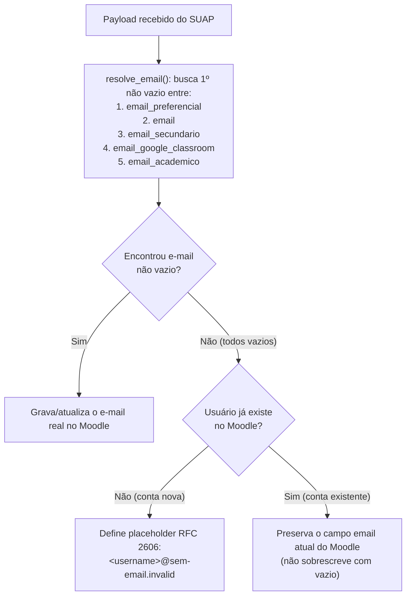

## Sintoma

1. Relatórios administrativos do Moodle listam contas de usuários ativas (não suspensas) com o campo **Endereço de e-mail** (`email`) vazio nos ambientes institucionais (Acadêmico, Presencial, Projetos ou Aberto).
2. Usuários sem e-mail cadastrado na origem (como discentes estrangeiros recém-ingressos ou prestadores de serviço sem e-mail informado no SUAP) conseguem autenticar na tela do provedor OAuth2, mas recebem **erro ao retornar para o Moodle** (`/auth/suap/authenticate.php`).

## Contexto

O Moodle exige que toda conta de usuário possua um endereço de e-mail para operações internas e notificações. Contudo, nos sistemas de origem (SUAP e diretórios legados), existem vínculos válidos cujo cadastro não possui nenhum endereço de e-mail preenchido.

### 1. Comportamento da API do SUAP (Origem do Problema)

Quando um usuário não possui e-mail cadastrado no SUAP, os endpoints consumidos pela integração (`/api/rh/eu/`, `/api/rh/meus-dados/`, `/api/ensino/meus-dados-aluno/` e o payload de sincronização de diários) **não omitem os atributos nem retornam `null`**: eles retornam **strings vazias (`""`)** em todos os campos de e-mail:

```json
{
  "identificacao": "<MATRICULA_OU_CPF>",
  "email": "",
  "email_secundario": "",
  "email_google_classroom": "",
  "email_academico": ""
}
```

Como o dado já vem em branco da própria fonte autoritativa (SUAP), **não é possível — nem seguro sob a ótica da LGPD e da integridade cadastral — que o Moodle tente adivinhar ou inventar um endereço de e-mail real** para o usuário.

### 2. Impacto nas Versões Anteriores dos Plugins

- **No `auth_suap` até a versão `20260908081` (`v4.5.081`)**:
  A resolução de e-mail utilizava o operador de coalescência nula do PHP (`??`):
  ```php
  $email = $userdata->email_preferencial ?? ($userdata->email ?? $userdata->email_secundario);
  ```
  Como o PHP considera string vazia (`""`) como um valor definido (não nulo), o operador `??` não avançava para os campos seguintes e atribuía `""` ao usuário, provocando falha no retorno do login no Moodle ou sobrescrevendo o campo com vazio.
- **No `local_suap` até a versão `20260612111` (`v4.5.111`, anterior à `v4.5.119`)**:
  A rotina de sincronização de matrículas (`sync_up_enrolments.php`) consultava apenas `email` e `email_secundario`. Quando ambos vinham como `""` do SUAP, o registro do usuário era criado ou atualizado no banco do Moodle com o campo `email` vazio.
- **Métodos legados (`ldap` e `oauth2` nativo)**:
  Contas sincronizadas no passado via LDAP ou pelo plugin `OAuth 2` nativo do Moodle sem atributo de e-mail preenchido no diretório permanecem com o campo vazio até que passem pelo fluxo atualizado de sincronização/autenticação e possuam e-mail na origem.

### 3. Solução Implementada nos Plugins (`auth_suap` e `local_suap`)

A partir das versões **`auth_suap >= 20260918082` (`v4.5.082`)** e **`local_suap >= 20260918119` (`v4.5.119`)**, o tratamento de e-mail foi padronizado através do método `resolve_email()`:

1. **Ordem de Prioridade dos Campos**:
   O integrador aplica `trim()` e ignora valores `null`, ausentes ou strings vazias (`""`), selecionando o **primeiro valor não vazio** na seguinte ordem:
   1. `email_preferencial`
   2. `email`
   3. `email_secundario`
   4. `email_google_classroom`
   5. `email_academico`

2. **Fallback Técnico na Criação de Conta (`@sem-email.invalid`)**:
   Se o usuário ainda não existir no Moodle e todos os 5 campos vierem vazios do SUAP, a conta é criada utilizando o domínio reservado pela **RFC 2606**:
   ```text
   <username>@sem-email.invalid
   ```
   O sufixo `.invalid` é padronizado pela IETF especificamente para indicar endereços sabidamente inexistentes: evita o erro 500 no login do Moodle, identifica claramente que o usuário não possui e-mail na origem e garante que nenhum servidor SMTP tente entregar mensagens externas indevidamente.

3. **Preservação na Atualização de Conta Existente**:
   - Se o usuário **já existir** no Moodle e o SUAP retornar todos os campos de e-mail vazios (`""`), o plugin **preserva o e-mail já salvo no Moodle** em vez de apagá-lo.
   - Assim que o usuário cadastrar ou atualizar qualquer um dos 5 e-mails no SUAP, o endereço real substituirá automaticamente o valor vazio ou o placeholder `@sem-email.invalid` no próximo login (via `auth_suap`) ou na próxima sincronização de diário (via `local_suap`).



## Procedimento

### 1. Verificar as Versões Instaladas no Ambiente

1. No Moodle, acesse **Administração do site > Plugins > Visão geral dos plugins** (`/admin/plugins.php`).
2. Localize os plugins `auth_suap` e `local_suap` e verifique a coluna de versão:
   - **`auth_suap`**: deve ser igual ou superior a **`20260918082`** (`v4.5.082`).
   - **`local_suap`**: deve ser igual ou superior a **`20260918119`** (`v4.5.119`).
3. Caso o ambiente esteja com versões anteriores (por exemplo, `auth_suap = 20260908081` e `local_suap = 20260612111`), programe a atualização da imagem/pacote dos plugins para eliminar o erro no retorno de login e ativar a resolução completa dos 5 campos.

### 2. Regularizar Contas Afetadas

Como o Moodle apenas consome os dados cadastrais fornecidos pelo SUAP, a regularização definitiva de um endereço de e-mail válido ocorre na origem:

1. **Preenchimento no SUAP**:
   - O usuário (aluno, servidor ou prestador de serviço) ou o setor de registro acadêmico/gestão de pessoas deve atualizar o e-mail no cadastro do SUAP.
2. **Sincronização Automática no Moodle**:
   - **Usuários com `Autenticação OAuth2 SUAP` (`auth_suap`)**: basta realizar um novo login no Moodle após a atualização no SUAP para que o e-mail seja atualizado automaticamente.
   - **Alunos vinculados a diários integrados (`local_suap`)**: a atualização também ocorre automaticamente quando o diário é sincronizado pelo integrador SUAP–AVA.
   - **Contas legadas com método `LDAP` ou `OAuth 2` nativo**: devem utilizar o método `Autenticação OAuth2 SUAP` (nos AVAs integrados ao SUAP) ou atualizar o perfil localmente quando se tratar de ambiente de autocadastro (Moodle Aberto).

## Quando escalar

- Quando o usuário possuir e-mail devidamente preenchido nas telas do SUAP, mas a API (`/api/rh/meus-dados/` ou `/api/rh/eu/`) continuar retornando `""` em todos os campos de e-mail — situação que caracteriza falha na API do SUAP e deve ser encaminhada à equipe responsável pelo desenvolvimento/manutenção do SUAP (DIGTI).

## Equipe responsável

- **Equipe de AVA / Educação a Distância**: manutenção e atualização dos plugins `auth_suap` e `local_suap` nos ambientes Moodle.
- **Diretoria de Gestão de TI (DIGTI / Equipe SUAP)**: manutenção da API do SUAP e regras de exposição dos atributos de e-mail dos vínculos.
- **Secretarias Acadêmicas / Gestão de Pessoas / Próprio Usuário**: atualização cadastral do endereço de e-mail no SUAP.

## Links oficiais

- [Issue #53 do `moodle-auth_suap` — Login SUAP para usuários sem CPF/e-mail](https://github.com/suap-ava-suite/moodle-auth_suap/issues/53)
- [Issue #57 do `moodle-local_suap` — E-mail de fallback no `sync_up_enrolments`](https://github.com/suap-ava-suite/moodle-local_suap/issues/57)
- [SSO do Moodle com o SUAP (plugin `auth_suap`)](sso-moodle-auth-suap.md)
- [Integração SUAP–Moodle: visão geral](integracao-suap-moodle-visao-geral.md)

## Nível de confiabilidade

Confirmado.

## Notas adicionais

- O domínio `.invalid` é reservado pela IETF na [RFC 2606 (Reserved Top Level DNS Names)](https://datatracker.ietf.org/doc/html/rfc2606), garantindo que nenhum endereço `@sem-email.invalid` colida com domínios reais na Internet.
- Em conformidade com a LGPD (princípio da exatidão dos dados, Art. 6º, V), o integrador não gera endereços fictícios em domínios institucionais reais quando o titular não possui e-mail cadastrado na base de origem.
