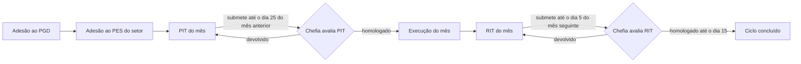

## Sintoma

O SUAP não tem documentação própria sobre o Programa de Gestão e Desempenho (PGD). Quem participa precisa descobrir pela prática o que é cada documento (adesão, PES, PIT, RIT), em que ordem eles acontecem e quais são os prazos.

## Contexto

O módulo atual do PGD no SUAP fica em `https://suap.ifrn.edu.br/pgd2/`. A página de entrada do servidor é **Meu PGD** (`/pgd2/meu_pgd/`), e as tarefas atrasadas aparecem em **Minhas Pendências no PGD** (`/pgd2/pendencias_avisos_pgd/`).

### Conceitos

| Sigla / termo | O que é | Quem faz |
|---|---|---|
| **Adesão ao PGD** | Pedido do servidor para participar do programa. Tem data de início e fica vigente até um desligamento. | Servidor solicita; chefia defere. |
| **PES** – Plano de Entregas Setorial | Lista de entregas do setor num período (ex.: um trimestre), com descrição, critério de avaliação e meta. | Chefia do setor cadastra; instância superior avalia. |
| **Adesão ao PES** | Vínculo do servidor ao PES de um setor. Um servidor pode estar em mais de um PES (setor principal e outros). | Servidor solicita; chefia defere. |
| **Calendário PIT/RIT** | Períodos (normalmente mensais) abertos para planejamento e relato. | Gestão do PGD. |
| **PIT** – Plano Individual de Trabalho | Planejamento do mês: regime, cronogramas e entregas individuais vinculadas às entregas do PES. | Servidor cadastra; chefia aprova/homologa. |
| **RIT** – Relatório Individual de Trabalho | Execução do mês: o que foi feito em cada entrega planejada, com horas e evidências. | Servidor cadastra; chefia homologa. |

### Fluxo

### Prazos

Conforme as orientações exibidas no próprio PIT:

- **Até o dia 25** de cada mês: submeter à chefia o PIT do mês seguinte.
- **Até o fim do mês**: a chefia avalia o PIT submetido.
- **Até o dia 5** após o mês de execução: submeter o RIT à chefia.
- **Até o dia 15**: a chefia avalia e homologa os RITs.

### Situações comuns

- PIT/RIT: **Em Fase de Cadastro** → **Em fase de Cadastro/Aguardando envio para Aprovação/Homologação** (requisitos mínimos cumpridos; o botão de solicitação aparece) → (solicitação enviada) → **Homologado**.
- O RIT do mês nasce junto com o PIT e fica "Em Fase de Cadastro" até ser preenchido.

### Indicadores de horas no topo do PIT/RIT

- **Horas previstas para planejamento**: carga do mês calculada pelo sistema (dias úteis × jornada, descontando feriados do calendário).
- **Horas planejadas no próprio setor / em outros setores / sem vínculo**: soma do tempo planejado nas entregas, por origem do PES.
- **Horas executadas** (no RIT): soma das horas informadas nas entregas executadas, inclusive o percentual em teletrabalho.

!!! tip "Fração de hora"
    O tempo no PGD é informado em **fração decimal de hora**: `1,50` = 1h30min e `13,50` = 13h30min. Veja [PGD e RSC – preenchimento de tempo](../suap/pgd-rsc-preenchimento-tempo.md).

## Procedimento

Artigos desta categoria:

1. [Cadastrar o PIT do mês](cadastrar-pit.md)
2. [Replicar o PIT de um mês anterior](replicar-pit-mes-anterior.md)
3. [Preencher o RIT do mês](preencher-rit.md)

## Quando escalar

- Adesão, PES ou calendário PIT/RIT ausentes ou com período errado: procurar a chefia imediata ou a gestão do PGD do campus.
- Erro do sistema: usar **Reportar erro** no rodapé da página ou abrir chamado na Central de Serviços do SUAP.

## Equipe responsável

Chefia imediata (aprovação de PIT/RIT e PES) e gestão de pessoas do campus/Reitoria (regras do programa).

## Links oficiais

Vídeos indicados nas orientações sistêmicas do SUAP:

- [Criando um Plano de Entregas Setorial (PES)](https://youtu.be/cqqtSXKoA_4)
- [Avaliando o PES](https://youtu.be/7iXDppIgA_c)
- [Regras para adesão](https://youtu.be/2UbeqI7zZjY)
- [Adesões ao PGD e ao PES no SUAP](https://youtu.be/H6D0oBDtrbc)
- [Fazendo um PIT no SUAP](https://youtu.be/yAqU6UmPL_c)
- [Chefia aprovando adesão, PES, PIT e RIT](https://youtu.be/J1JCPM7aDoI)
- [Elaborando um RIT no SUAP](https://youtu.be/Nph5WQ53T2Y)

## Nível de confiabilidade

Prático: baseado no uso do sistema; regras e telas podem mudar com novas versões do SUAP.

## Notas adicionais

- O PIT pode ser alterado a qualquer tempo, tanto pela chefia quanto pelo participante (orientação local vigente desde 29/09/2022).
- Alterar um PIT já homologado pode exigir nova solicitação de aprovação; o próprio PIT avisa no topo quando há "dados novos ou alterações" que justifiquem isso.
